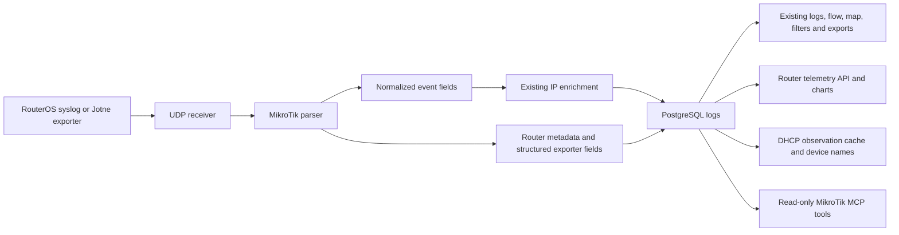

# MikroTik adaptation: design and compatibility

## Source baseline and review

The fork was fast-forwarded from `1ae8a14` to upstream **3.7.2**, commit **4f218128b9159e67095a37796f10dbdfa441b099**, before development. Work is isolated on `mikrotik-adaptation`. The Jotne source reviewed is commit **bda0ece8fae288ea0bfad2986be7df1aa9946083**, exporter **5.6**. Its current repository revision matches the source previously reviewed for the Splunk upgrade.

The analysis traced container startup, receiver batching and failure isolation, SQL schema/migrations and indexes, IP enrichment, client identity caches, background jobs, API query construction, authentication and token scopes, React polling/filter state, flow aggregation, map queries, settings round trips, and MCP dispatch. The browser extension and UniFi policy matcher are vendor-specific; they remain in the source for upstream maintenance but are excluded from the MikroTik product workflow.

## What makes the upstream application work

One container runs PostgreSQL 16, the Python receiver, FastAPI/Uvicorn and cron under Supervisor. React is compiled into static assets served by FastAPI; there is no Node process in the runtime. External PostgreSQL remains an option: the entrypoint disables the embedded database when a remote DB host is configured.

The receiver accepts dual-stack UDP on container port 514. It parses messages into a shared event dictionary, optionally enriches public IPs, and writes batches of 50 events or flushes after two seconds. The upstream loop retains its parse/enrichment exception isolation and row-by-row SQL fallback. UDP is not a guaranteed-delivery transport.

The central `logs` table drives the entire UI. The same timestamp, addresses, ports, protocol, interfaces, action, direction and enrichment fields support paginated logs, negation-aware filters, IANA service names, statistics, event-count Sankey graphs, an interface matrix, host drill-down, threat maps and CSV export. The live log view polls every five seconds; it is not a packet-capture or NetFlow collector. Saved views persist the flow filters.

GeoIP/ASN uses local MaxMind databases. AbuseIPDB uses a memory/database cache, request budgeting, delayed backfill and an optional blacklist. Reverse DNS has its own cache. The scheduler handles retention, identity refresh, blacklist updates and auth cleanup. API sessions, roles and scoped tokens are enforced before route dispatch; MCP has an additional enable switch, scopes and optional audit records.

## Adapted data path

`ROUTER_PLATFORM=mikrotik` selects the new backend parser and disables controller configuration resolution. The UI build uses `VITE_ROUTER_PLATFORM=mikrotik`. The supplied MikroTik Compose file selects both consistently. The original profile remains available for upstream regression testing; the Docker build argument controls both stages.

### Native RouterOS events

The parser accepts BSD/RFC3164 headers with priority, ISO8601 timestamps with offset, and RouterOS headerless default logging. Headerless events use receipt time and the datagram's sender address. BSD timestamps use the container timezone and the existing year-rollover protection. Original messages remain in `raw_log`.

RouterOS firewall fields such as `in:`, `out:`, `proto`, `src-mac`, connection state, TCP flags, endpoint tuples and packet length are normalized. Bracketed IPv6 endpoints retain ports. Bare IPv6 addresses and ICMP events do not acquire invented ports. Unknown interface placeholders become null. Bridge-port annotations remain in the raw event, while interface classification uses the base interface.

The action is **unknown** when the log does not establish it. This is stored as SQL NULL to preserve the upstream unknown-action filters. Recognized Jotne action codes and explicit allow/drop prefixes supply an evidenced label; exact user mappings can override them. Log, passthrough, jump and connection-state markers do not imply acceptance. A prefix describes the logging rule's claimed action, not proof of an eventual verdict after later firewall processing. No MikroTik action falls back to the upstream UniFi parser's permissive default.

DHCP assignment/deassignment events populate client address, MAC, hostname and server observations. DNS query IDs, names and record types are retained where emitted. Wi-Fi association events and system/VPN/login messages remain searchable without inventing packet-flow information.

### Jotne telemetry

Space-separated key/value messages and semicolon-separated RouterOS `as-value` messages are parsed, including quoted strings, units, dotted keys and hyphenated keys. Fields and unknown future exporter families remain in JSONB rather than being discarded.

| Exporter family | Use in this adaptation |
|---|---|
| `version`, `sysinfo`, `ntp` | Collector version, RouterOS/model/identity and clock status |
| `resource` | CPU, memory, disk and uptime cards/history |
| `if_traffic` | Interface counter snapshots and calculated receive/transmit bit rates |
| `health` | Sensor values |
| `pool`, `address_lists` | Address-pool and list-count inventory |
| `neighbor` | Merge separate attributes by router and neighbor ID |
| `kids` | Per-device exported traffic counters |
| `route`, `ospf`, `bgp` | Optional routing snapshots |
| `ppp`, `ipsec`, `wifi`, `upnp` | Optional session, wireless and mapping snapshots |
| Other families | Preserved structured records and raw log search |

All telemetry uses `log_type=telemetry`, with `router_host`, `router_serial`, `router_topics` and `router_fields` on the same retained log table. No additional time-series database is needed. New indexes cover router/time and exporter family/time. The normal non-DNS retention policy covers telemetry too.

Resource percentages use Jotne's free/total values and preserve MB units. Interface bit rates are `8 × counter_delta / seconds`; resets, duplicate times and gaps over 15 minutes produce no rate. Packet-event counts in Flow View are not labeled bandwidth. Snapshot views are bounded and disclose their sample limit; full retained records remain searchable in Log Stream.

Neighbor fragments are merged only within the same router and neighbor ID, because the exporter emits one attribute per message. Normal complete records use their latest snapshot. Reported serial numbers group hostname aliases for the router selector; original source labels remain on the events. This avoids presenting relayed timestamp/header aliases as extra physical routers and does not authenticate an identifier. No VLAN ID, device ownership or trust status is inferred from an interface name, DHCP observation or neighbor record.

## Identity and configuration

The original internal table name `unifi_clients` is retained as a compatibility cache. In the MikroTik profile it is populated only by observed DHCP assignments, so existing SQL joins in logs, statistics, flow views and host drill-down continue resolving names. Older out-of-order lease observations cannot replace newer ones. Deassignment clears the matching current address. These names remain observations, not authenticated identities or trusted allowlists; MAC-only cache scope retains the upstream single-network assumption.

The new setup page selects exact WAN names and edits local interface labels, VPN badges/CIDRs and firewall prefix meanings. It does not request router credentials. Saving is one local database transaction followed by the existing receiver reload signal. Input validation occurs before writes. Prefix mappings are included in settings export/import. WAN/gateway auto-discovery inherited from UniFi-specific patterns is only best-effort; do not treat absent detected WAN addresses as proof that a WAN is down.

The MikroTik profile does not register UniFi HTTP routes or permit UniFi controller/firewall MCP tools. It adds read-only status, resources and observed-client MCP tools using `system.read`. API route scope coverage includes the new endpoints; configuration writes require `settings.write`. The upstream startup message that prints a proxy trust token is suppressed in this profile. Fresh embedded database initialization also transfers the authentication and queue tables to the existing application role, so schema migrations do not fail ownership checks. This ownership step is not run against external databases.

## Feature preservation

| Feature | Result |
|---|---|
| Live logs, pause/resume, details, pagination, filters | Retained; adds structured RouterOS detail and telemetry filtering |
| Dashboard, Sankey, interface matrix, host drill-down, saved views | Retained; MikroTik flow filters include unknown actions and redirect events |
| Threat map, local GeoIP/ASN, AbuseIPDB, rDNS | Retained; optional data/credentials required |
| Multi-WAN, labels, VPN badges/CIDRs | Retained with local RouterOS interface configuration |
| Friendly device names | Adapted to passive DHCP observations |
| CSV export, settings backup/restore, retention, themes, mobile layout | Retained |
| Sessions, admin/viewer roles, API tokens, MCP, audit | Retained with profile-specific route/tool coverage |
| Pi-hole integration | Retained as optional; AdGuard was not implemented upstream and is not claimed here |
| External PostgreSQL | Retained through the existing entrypoint and DB parameters |
| UniFi controller discovery, policy toggles and browser extension | Excluded from the MikroTik workflow |

## Staging and limits

Staging runs on an Ubuntu host, separately from existing services, with a dedicated Docker volume, log rotation, a 2 GiB memory limit and two CPU limit. HTTP and UDP host ports bind only to loopback. A desktop SSH tunnel provides preview access. Authentication is disabled only in this isolated replay environment; the Compose default enables it. Enable authentication and obtain approval before exposing a deployment or changing router logging.

The private replay source is an existing bounded Splunk export, stored outside Git. Replay reconstructs syslog headers using original event epochs, preserving timing for charts and counter rates. An on-screen banner labels historical staging replay. No captured syslog, host inventory, real credentials, enrichment databases or replay state is committed.

No router was contacted, no exporter was installed/replaced, no router rule was modified, and Splunk's collection remains independent. Native RouterOS CEF and TCP/TLS framing are not implemented in this UDP adapter. Optional exporter sections stay empty when their source data is absent. An empty threat map without GeoIP databases is expected; it is not evidence of absent threats. The adaptation is not a complete replacement for arbitrary Splunk SPL searches or every custom Splunk dashboard.

## Primary references

- [Upstream project](https://github.com/jmasarweh/UniFi-Insights-Plus), pinned commit above; [original README](UPSTREAM_README.md) and [upstream architecture](wiki/architecture.md).
- [Jotne exporter and Splunk configurations](https://github.com/Jotne/MikroTik), including `README/Data_to_Splunk_using_Syslog`, `README/FIREWALL.txt`, `default/props.conf` and lookup definitions.
- [Official RouterOS documentation index](https://manual.mikrotik.com/llms.txt), read before selecting detailed pages.
- [Logging and wire formats](https://manual.mikrotik.com/docs/diagnostics-monitoring-and-troubleshooting/log.md).
- [Remote logging action reference](https://manual.mikrotik.com/docs/cli-reference/system/logging/action.md).
- [Firewall matchers/actions](https://manual.mikrotik.com/docs/firewall-and-quality-of-service/firewall/common-firewall-matchers-and-actions.md) and [filter chains](https://manual.mikrotik.com/docs/firewall-and-quality-of-service/firewall/filter.md).
- [RouterOS scripting](https://manual.mikrotik.com/docs/developer-guides/scripting.md).

The exporter syntax and its custom prefix convention come from Jotne, not an official RouterOS wire-format guarantee. The upstream Business Source License and attribution remain intact in `LICENSE`.
